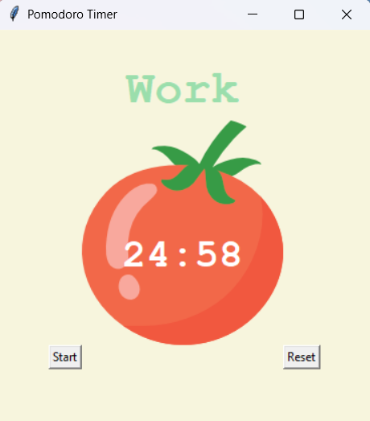

# 🍅 Pomodoro Timer

A simple and interactive **Pomodoro Timer** desktop application built using Python and Tkinter. This application helps users improve productivity and manage their study or work sessions using the Pomodoro Technique.

## 📌 About the Project

The Pomodoro Technique is a time-management method that divides work into focused intervals followed by short breaks.

This application automates the process by providing:
- 25-minute focused work sessions.
- 5-minute short breaks.
- 20-minute long breaks after completing four work sessions.
- A visual countdown timer.
- A session completion tracker.

## ✨ Features

- **Work Session:** 25-minute focused work interval.
- **Short Break:** 5-minute break after each work session.
- **Long Break:** 20-minute break after completing four work sessions.
- **Automatic Timer:** Automatically switches between work and break sessions.
- **Progress Tracker:** Displays checkmarks for completed work sessions.
- **Reset Functionality:** Resets the timer and session progress.
- **Simple GUI:** Clean and user-friendly interface built with Tkinter.

## 🛠️ Technologies Used

- **Python** – Core programming language.
- **Tkinter** – GUI development.
- **Math Module** – Countdown calculations.

## 📂 Project Structure

```text
Pomodoro-Timer/
│
├── main.py          # Main application code
├── tomato.png       # Tomato image used in the interface
└── README.md        # Project documentation
```

## ⚙️ Installation and Setup

### 1. Clone the Repository

```bash
git clone https://github.com/YOUR-USERNAME/Pomodoro-Timer.git
```

### 2. Navigate to the Project Directory

```bash
cd Pomodoro-Timer
```

### 3. Run the Application

```bash
python main.py
```

**Note:** Make sure `tomato.png` is in the same directory as `main.py`.

## 🎮 How to Use

1. Run the Python application.
2. Click the **Start** button to begin a 25-minute work session.
3. Once the work session finishes, the timer automatically starts a 5-minute short break.
4. After four completed work sessions, a 20-minute long break is scheduled.
5. Checkmarks indicate completed work sessions.
6. Click **Reset** to restart the timer and clear the progress.

## 📸 Application Preview

Here is a preview of the Pomodoro Timer application:



## 🚀 Future Improvements

- Add sound notifications when sessions end.
- Allow users to customize work and break durations.
- Add daily productivity statistics.
- Save completed sessions and track progress.
- Add pause and resume functionality.
- Improve the user interface with additional themes.

## 📚 What I Learned

Through this project, I practiced:

- Building desktop applications using Python Tkinter.
- Creating GUI layouts using the Grid geometry manager.
- Implementing countdown timers using `window.after()`.
- Managing application state using global variables.
- Working with callback functions and event-driven programming.
- Updating GUI components dynamically.

## 👨‍💻 Author

**Kaushik Kumar**

- GitHub: [kaushik6819](https://github.com/kaushik6819)
- Portfolio: [kaushikkumar.codes](https://kaushikkumar.codes)

---

⭐ If you find this project useful, consider giving it a star!
